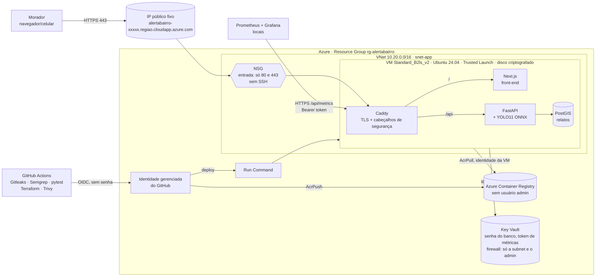

# AlertaBairro · Arquitetura, segurança e custos

## 1. Diagrama da arquitetura

| Camada | Tecnologia | Observação |
|---|---|---|
| Proxy | Caddy 2 | HTTPS automático (Let's Encrypt), HSTS, `X-Frame-Options`, `nosniff`, limite de upload |
| Front-end | Next.js 16 (standalone) | Usuário `node` (não root), sem npm na imagem final |
| API | FastAPI + onnxruntime | Usuário uid 10001, container *read-only*, `cap_drop: ALL` |
| Visão | YOLO11 exportado para ONNX | Imagem ~5x menor que com PyTorch; roda em CPU |
| Banco | PostGIS 16 | Rede Docker `internal` (sem porta exposta e sem saída para a internet) |
| Infra | Terraform (azurerm) | Resource Group, VNet, NSG, IP público, VM, ACR, Key Vault, identidade OIDC |
| CI/CD | GitHub Actions | Actions fixadas por SHA; deploy só a partir da `main` |
| Observabilidade | Prometheus + Grafana | 4 sinais de ouro, 3 alertas |

## 2. Controles de segurança (DevSecOps)

| Risco | Controle | Onde |
|---|---|---|
| Segredo no Git | Gitleaks barra o pipeline; `.env`, `*.tfstate` e `*.tfvars` no `.gitignore` | `ci-cd.yml`, `.gitignore` |
| Código vulnerável (SQLi etc.) | Semgrep (Python, JS, Dockerfile, Terraform, Actions); SQL sempre parametrizado | `ci-cd.yml`, `backend/app/db.py` |
| Dependência ou imagem com CVE | Trivy na imagem (HIGH/CRITICAL com correção barram); Dependabot semanal | `ci-cd.yml`, `dependabot.yml` |
| Infra mal configurada | `terraform validate` + Trivy config | `ci-cd.yml` |
| Ataque à cadeia de suprimentos | Actions fixadas por SHA; Gitleaks baixado com checksum; Trivy v0.69.3 (versão segura pós-incidente de mar/2026) | `ci-cd.yml` |
| Senha da nuvem vazada do GitHub | Login por OIDC (*federated credential*): o GitHub não guarda segredo; só a `main` e o ambiente `producao` do repositório são aceitos | `infra/github_oidc.tf` |
| Pipeline com poder demais | Identidade do GitHub com Reader no RG, AcrPush só no ACR e Virtual Machine Contributor só na VM | `infra/github_oidc.tf` |
| Acesso remoto indevido | Sem regra para a porta 22; login por senha desligado; administração via Run Command (exige Entra ID + RBAC) | `infra/network.tf`, `infra/compute.tf` |
| Roubo do token da VM via container (SSRF) | `iptables` bloqueia o IMDS (169.254.169.254) para os containers | `deploy/deploy.sh` |
| Senha fraca/fixa | Senha do banco e token gerados pelo Terraform, guardados no Key Vault e com validade de 1 ano (força a rotação) | `infra/keyvault.tf` |
| Exclusão maliciosa de segredos | Key Vault com soft delete e purge protection (7 dias para recuperar) | `infra/keyvault.tf` |
| Key Vault exposto | Firewall do Key Vault: só a subnet da VM (service endpoint) e o IP de quem roda o Terraform | `infra/keyvault.tf` |
| Registry com senha | ACR com usuário admin desligado; VM baixa imagens pela identidade gerenciada (AcrPull) | `infra/acr.tf` |
| Boot adulterado | Trusted Launch (Secure Boot + vTPM) | `infra/compute.tf` |
| Dados em repouso | Disco gerenciado criptografado pela Azure (SSE) | `infra/compute.tf` |
| Escalada no container | Usuário não root, `no-new-privileges`, `cap_drop: ALL`, API *read-only* | Dockerfiles, `deploy/docker-compose.yml` |
| Upload malicioso | Tipo, tamanho (5 MB) e integridade validados; limite de pixels contra "decompression bomb" | `backend/app/main.py` |
| Métricas expostas | `/metrics` exige token Bearer | `backend/app/main.py` |

**Riscos aceitos** (aparecem no Trivy como LOW/MEDIUM e não barram o pipeline):
- *Placa de rede com IP público* (AZU-0076): necessário para o site; um Load Balancer/Application Gateway na frente custaria mais que a VM.
- *NIC sem NSG* (AZU-0068): falso positivo; o NSG está associado à subnet **e** à placa de rede.

## 3. Modelo de responsabilidade compartilhada

| Responsabilidade | Azure | Nós (grupo) |
|---|:---:|:---:|
| Data center, hardware, rede física | ✅ | |
| Hipervisor e isolamento entre VMs | ✅ | |
| Disponibilidade dos serviços gerenciados (ACR, Key Vault, Entra ID) | ✅ | |
| Sistema operacional da VM (patches) | | ✅ (`unattended-upgrades`) |
| Docker, imagens e dependências | | ✅ (Trivy + Dependabot) |
| Código da aplicação | | ✅ (Semgrep + testes) |
| Configuração de rede (NSG, VNet) | | ✅ (Terraform) |
| Identidade e permissões (RBAC, OIDC) | | ✅ (menor privilégio) |
| Criptografia: ativar e gerenciar | ferramenta | ✅ decisão de usar |
| Dados dos moradores (LGPD) | | ✅ |
| Backup do banco | | ✅ (ver melhorias) |

Como usamos **IaaS (VM)**, a fronteira fica baixa: tudo do sistema operacional para cima é nosso. Com serviços gerenciados (Azure Database for PostgreSQL, Container Apps) a Azure assumiria patches de SO e do banco.

## 4. Dados pessoais (LGPD)

| Dado | Onde fica | Base / cuidado |
|---|---|---|
| Localização do relato (lat/lon) | PostGIS, volume `pgdata` no disco criptografado da VM | Necessária para o mapa; sem vínculo com identidade |
| Descrição do relato | PostGIS | Texto livre, limitado a 500 caracteres |
| **Foto** | **Não é armazenada** | Analisada em memória pelo YOLO e descartada (minimização) |
| IP do visitante | Logs do Caddy (rotacionados, 3 x 10 MB) | Segurança e auditoria; retenção curta |
| Métricas | Prometheus local (7 dias) | Agregadas, sem dado pessoal |

Não há cadastro de usuário, nome, e-mail ou CPF. Evolução prevista: borrar rostos e placas antes de qualquer armazenamento de imagem.

## 5. Estimativa de custo mensal (East US, pagamento conforme o uso)

| Item | Cálculo | US$/mês |
|---|---|---:|
| VM Standard_B2ls_v2 (2 vCPU, 4 GB) | 730 h × US$ 0,0416 | 30,37 |
| Disco Standard SSD 32 GB (E4) | preço fixo | 2,40 |
| IP público Standard estático | 730 h × US$ 0,005 | 3,65 |
| Azure Container Registry Basic | 30 dias × US$ 0,167 | 5,00 |
| Key Vault (poucas leituras por deploy) | US$ 0,03 a cada 10 mil operações | ≈ 0,01 |
| Transferência de saída (< 100 GB) | faixa gratuita | 0,00 |
| GitHub Actions (repositório público) | gratuito | 0,00 |
| **Total** | | **≈ 41,43** |

≈ R$ 225/mês, coberto pelo crédito de US$ 100 do Azure for Students por cerca de 2 meses. Desalocar a VM fora das demonstrações (`az vm deallocate`) zera o custo de computação; disco, IP e ACR continuam sendo cobrados. Preços de referência: conferir na [calculadora da Azure](https://azure.microsoft.com/pricing/calculator/).

## 6. Melhorias futuras
- Backup diário do PostGIS para um Storage Account (`pg_dump` + política de ciclo de vida).
- Banco no Azure Database for PostgreSQL e containers no Azure Container Apps (menos responsabilidade nossa).
- Azure Front Door com WAF e rate limit por IP no envio de relatos.
- Alertmanager enviando os alertas para Teams/Discord.
- Estado do Terraform em Storage Account com lock.
